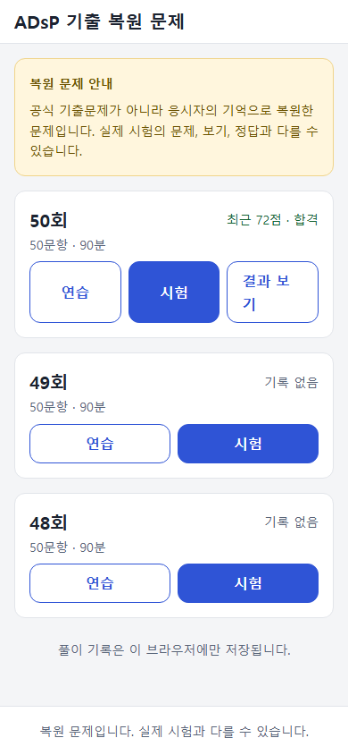
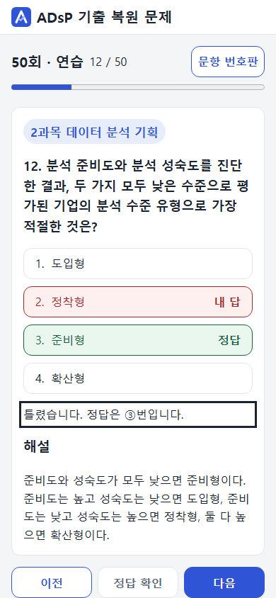
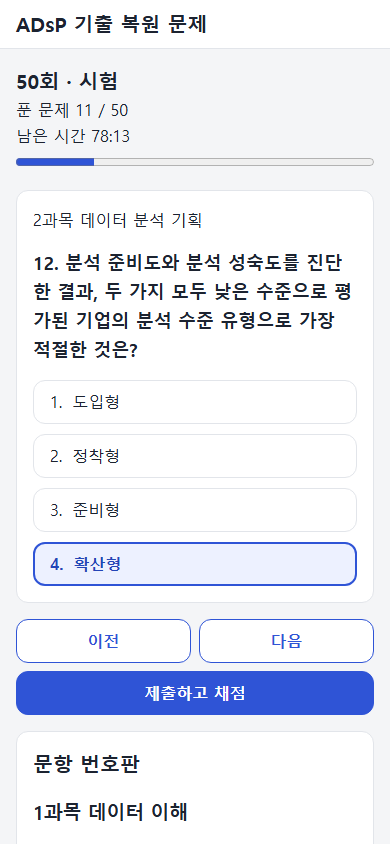
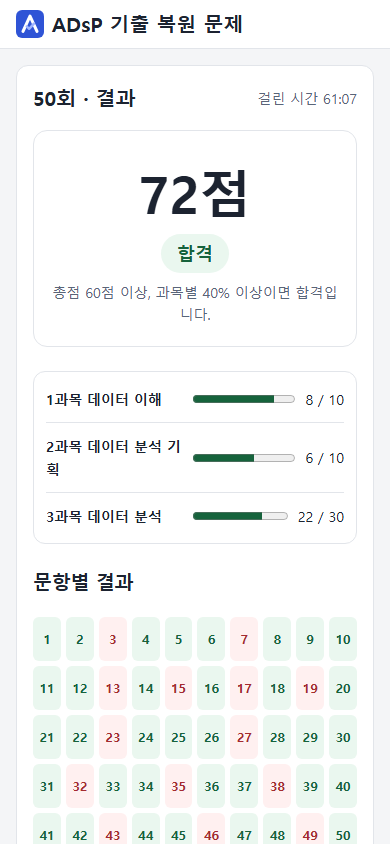
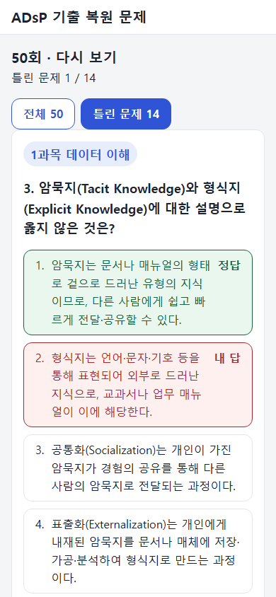

# ADsP CBT

ADsP(데이터분석 준전문가) 기출 복원문제를 회차별로 풀어 보는 사이트입니다.

**[사이트 열기](https://youneedpython.github.io/ADsP-CBT/)**

주소는 대소문자를 구분합니다. `ADsP-CBT`를 그대로 입력해야 열립니다.

| 회차 목록 | 연습 | 시험 | 결과 | 다시 보기 |
|:---:|:---:|:---:|:---:|:---:|
|  |  |  |  |  |

## 사용법

### 1. 회차 고르기

첫 화면에서 회차를 고르고 **연습**이나 **시험**을 누릅니다. 회원가입과 로그인은 없습니다.

### 2. 연습

한 문제씩 풀면서 바로 확인하는 방식입니다.

1. 보기를 고르고 **정답 확인**을 누르면 채점됩니다. 확인 전에는 답을 바꾸거나 같은 보기를 다시 눌러 선택을 풀 수 있습니다. 확인하면 정답과 내가 고른 답이 표시되고 해설이 나옵니다.
2. **다음**으로 넘어갑니다. 모르는 문제는 답을 고르지 않고 **다음**으로 건너뛸 수 있습니다. **문항 번호판**을 열면 원하는 문제로 바로 갈 수 있습니다.
3. 중간에 닫아도 다음에 **연습**을 누르면 이어서 풉니다. 처음부터 다시 풀려면 문항 번호판의 **처음부터 다시**를 누릅니다.

### 3. 시험

실제 시험처럼 50문항을 모두 푼 뒤 한 번에 채점하는 방식입니다.

1. 제한 시간은 90분입니다. 화면 위에 남은 시간과 푼 문제 수가 나옵니다.
2. 보기를 누르면 선택되고, 같은 보기를 다시 누르면 선택이 풀립니다. 채점 전에는 정답이 나오지 않습니다.
3. 다 풀었으면 **제출하고 채점**을 누릅니다. 안 푼 문제가 있으면 몇 개인지 알려 줍니다.
4. 시간이 끝나도 자동으로 제출되지 않습니다. 계속 풀거나 제출할 수 있습니다.
5. 중간에 닫아도 회차 목록의 **시험 이어 풀기**로 이어서 풉니다. 시간은 시험 화면을 보고 있는 동안만 흐릅니다. 닫거나 다른 탭으로 가면 멈추고, 돌아오면 이어집니다. 진행 중인 시험을 버리고 새로 시작하려면 문항 번호판의 **처음부터 다시**를 누릅니다.

### 4. 결과와 다시 보기

- 결과 화면에서 총점, 합격 여부, 과목별 점수, 문항별 정오를 확인합니다.
- **틀린 문제 보기**를 누르면 틀린 문제만 모아서 내 답, 정답, 해설을 함께 봅니다.
- 회차 목록의 **결과 보기**로 가장 최근 시험 결과를 다시 열 수 있습니다.

### 채점 기준

| 항목 | 기준 |
|---|---|
| 배점 | 문항당 2점, 50문항 100점 |
| 합격 | 총점 60점 이상이고 모든 과목에서 40% 이상 |
| 과목 | 1과목 데이터 이해 10문항, 2과목 데이터 분석 기획 10문항, 3과목 데이터 분석 30문항 |
| 안 푼 문제 | 틀린 것으로 채점 |

### 키보드

| 키 | 동작 |
|---|---|
| `1` `2` `3` `4` | 보기 선택 |
| `Enter` | 연습에서 정답 확인 |
| `←` `→` | 이전 / 다음 문제 |
| `Esc` | 열린 창 닫기 |

### 풀이 기록

풀이 기록은 지금 쓰는 브라우저에만 저장됩니다. 서버로 보내지 않으며 다른 기기나 다른 브라우저에서는 보이지 않습니다. 브라우저의 사이트 데이터를 지우면 기록도 지워집니다.

문의와 문제 제기는 [이 Repository의 Issues](https://github.com/youneedpython/ADsP-CBT/issues)로 받습니다.
