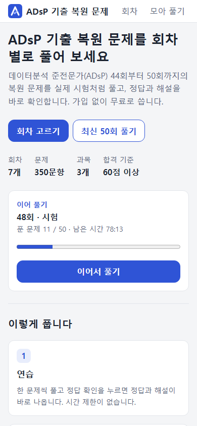
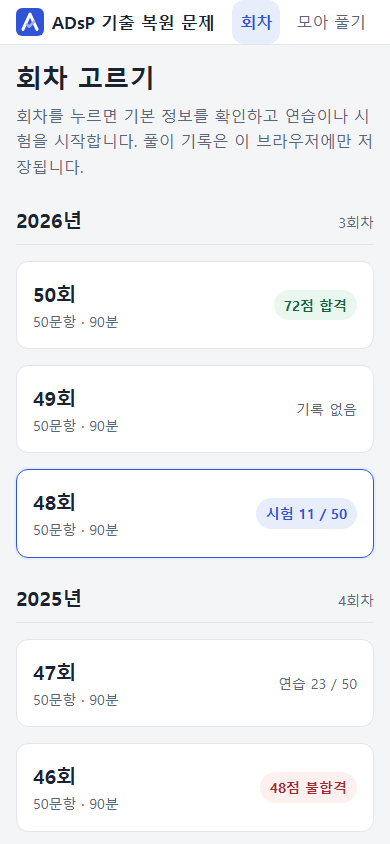
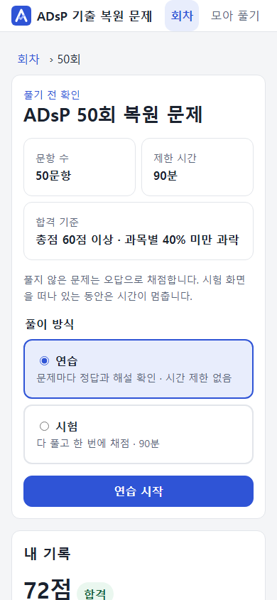
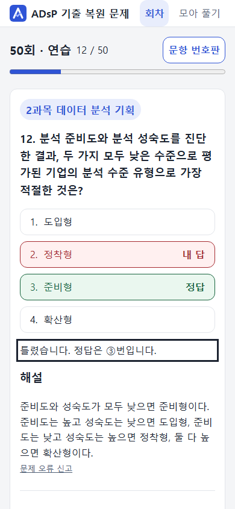
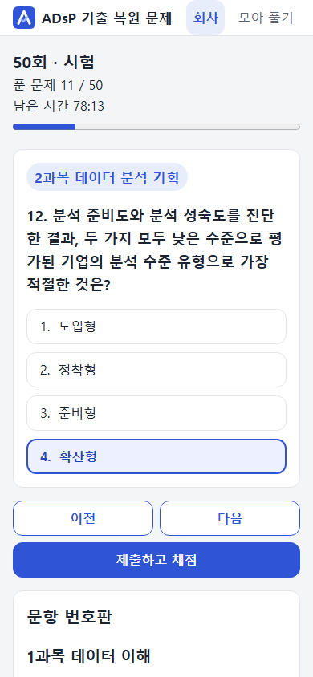
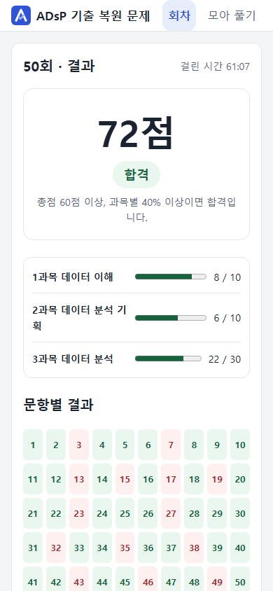
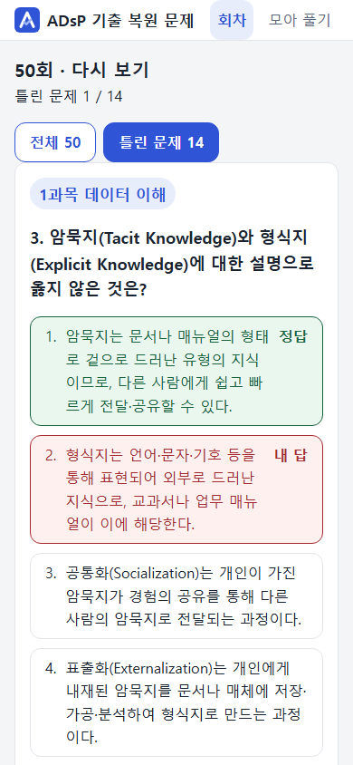
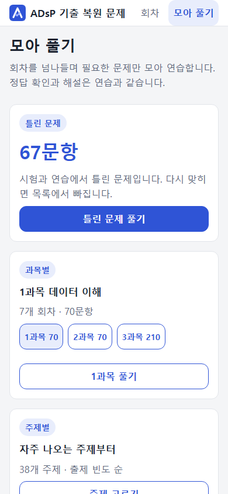
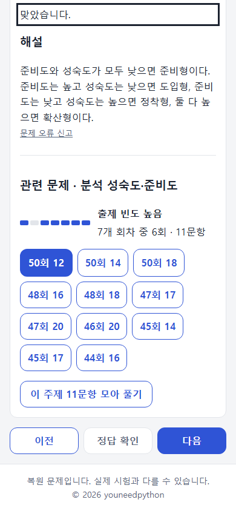

# ADsP CBT

ADsP(데이터분석 준전문가) 기출 복원문제를 회차별로 풀어 보는 사이트입니다.

**[사이트 열기](https://youneedpython.github.io/ADsP-CBT/)**

주소는 대소문자를 구분합니다. `ADsP-CBT`를 그대로 입력해야 열립니다.

| 첫 화면 | 회차 목록 | 회차 정보 |
|:---:|:---:|:---:|
|  |  |  |

| 연습 | 시험 | 결과 | 다시 보기 |
|:---:|:---:|:---:|:---:|
|  |  |  |  |

| 모아 풀기 | 관련 문제와 출제 빈도 |
|:---:|:---:|
|  |  |

## 사용법

### 1. 회차 고르기

1. 첫 화면에서 **회차 고르기**를 누릅니다. 맨 위의 **회차**를 눌러도 됩니다. 풀던 문제가 있으면 첫 화면의 **이어서 풀기**로 바로 돌아갑니다.
2. 회차 목록은 시행 연도별로 묶여 있습니다. 회차마다 내 기록(최근 점수, 진행 중인 시험이나 연습)이 함께 나옵니다.
3. 회차를 누르면 문항 수, 제한 시간, 합격 기준, 내 기록이 나옵니다. 풀이 방식을 **연습**이나 **시험** 중에서 고르고 시작 버튼을 누릅니다.

회원가입과 로그인은 없습니다.

### 2. 연습

한 문제씩 풀면서 바로 확인하는 방식입니다.

1. 보기를 고르고 **정답 확인**을 누르면 채점됩니다. 확인 전에는 답을 바꾸거나 같은 보기를 다시 눌러 선택을 풀 수 있습니다. 확인하면 정답과 내가 고른 답이 표시되고 해설이 나옵니다.
2. **다음**으로 넘어갑니다. 모르는 문제는 답을 고르지 않고 **다음**으로 건너뛸 수 있습니다. **문항 번호판**을 열면 원하는 문제로 바로 갈 수 있습니다.
3. 중간에 닫아도 그 회차의 **연습 이어 풀기**로 이어서 풉니다. 처음부터 다시 풀려면 문항 번호판의 **처음부터 다시**를 누릅니다.

### 3. 시험

실제 시험처럼 50문항을 모두 푼 뒤 한 번에 채점하는 방식입니다.

1. 제한 시간은 90분입니다. 화면 위에 남은 시간과 푼 문제 수가 나옵니다.
2. 보기를 누르면 선택되고, 같은 보기를 다시 누르면 선택이 풀립니다. 채점 전에는 정답이 나오지 않습니다.
3. 다 풀었으면 **제출하고 채점**을 누릅니다. 안 푼 문제가 있으면 몇 개인지 알려 줍니다.
4. 시간이 끝나도 자동으로 제출되지 않습니다. 계속 풀거나 제출할 수 있습니다.
5. 중간에 닫아도 첫 화면의 **이어서 풀기**나 그 회차의 **시험 이어 풀기**로 이어서 풉니다. 시간은 시험 화면을 보고 있는 동안만 흐릅니다. 닫거나 다른 탭으로 가면 멈추고, 돌아오면 이어집니다. 진행 중인 시험을 버리고 새로 시작하려면 문항 번호판의 **처음부터 다시**를 누릅니다.

### 4. 결과와 다시 보기

- 결과 화면에서 총점, 합격 여부, 과목별 점수, 문항별 정오를 확인합니다.
- **틀린 문제 보기**를 누르면 틀린 문제만 모아서 내 답, 정답, 해설을 함께 봅니다.
- 회차 정보의 **결과 보기**로 가장 최근 시험 결과를 다시 열 수 있습니다.

### 5. 모아 풀기

회차를 넘나들며 필요한 문제만 모아 연습 방식으로 풉니다. 맨 위의 **모아 풀기**를 누릅니다.

- **틀린 문제**: 최근 시험에서 틀렸거나 풀지 않은 문제와, 연습에서 틀린 문제를 모읍니다. 여기서 다시 맞히면 다음에 열 때 목록에서 빠집니다.
- **과목별**: 한 과목의 문제를 모든 회차에서 모읍니다(1과목 70, 2과목 70, 3과목 210문항).
- **주제별**: 같은 주제의 문제를 모읍니다. 아래 표에서 주제마다 몇 개 회차에 나왔는지와 문항 수를 볼 수 있습니다. 자주 나온 주제가 위에 있습니다.

### 6. 관련 문제와 출제 빈도

연습에서 정답을 확인하면, 그리고 다시 보기에서는 해설 아래에 그 문제의 주제가 나옵니다.

- **출제 빈도**: 그 주제가 몇 개 회차에 나왔는지 막대와 글로 보여 줍니다(예: 7개 회차 중 6회 · 11문항).
- **관련 문제**: 같은 주제의 다른 회차 문항 번호를 누르면 그 문제로 갑니다.
- **이 주제 모아 풀기**: 같은 주제의 문제만 이어서 풉니다.
- 시험 중에는 힌트가 되지 않도록 나오지 않습니다.

주제는 44회부터 50회까지 350문항을 주제 38개로 나눈 것입니다. 한 문항은 주제 하나에 들어갑니다.

### 합격 기준

두 조건을 모두 만족해야 합격입니다.

1. 총점 60점 이상 (50문항 중 30문항 이상 정답)
2. 과목마다 40% 이상 정답 (하나라도 못 미치면 과락으로 불합격)

| 과목 | 문항 수 | 배점 | 과락을 면하는 최소 정답 |
|---|---|---|---|
| 1과목 데이터 이해 | 10문항 | 20점 | 4문항 (8점) |
| 2과목 데이터 분석 기획 | 10문항 | 20점 | 4문항 (8점) |
| 3과목 데이터 분석 | 30문항 | 60점 | 12문항 (24점) |
| 합계 | 50문항 | 100점 | 30문항 (60점) |

- 문항당 2점입니다.
- 과락은 한 과목의 정답이 40%에 못 미치는 것입니다. 총점이 60점을 넘어도 과락인 과목이 하나라도 있으면 불합격입니다.
  - 예: 1과목 10, 2과목 3, 3과목 26문항 정답이면 총점은 78점이지만 2과목 과락으로 불합격입니다.
- 과목별 최소 정답(4 + 4 + 12 = 20문항)만 채워서는 40점이라 합격할 수 없습니다. 총 30문항 이상을 맞혀야 합니다.
- 안 푼 문제는 틀린 것으로 채점합니다.

### 키보드

| 키 | 동작 |
|---|---|
| `1` `2` `3` `4` | 보기 선택 |
| `Enter` | 연습에서 정답 확인 |
| `←` `→` | 이전 / 다음 문제 |
| `Esc` | 열린 창 닫기 |

### 풀이 기록

풀이 기록은 지금 쓰는 브라우저에만 저장됩니다. 서버로 보내지 않으며 다른 기기나 다른 브라우저에서는 보이지 않습니다. 브라우저의 사이트 데이터를 지우면 기록도 지워집니다.

문의와 문제 제기는 [이 Repository의 Issues](https://github.com/youneedpython/ADsP-CBT/issues)로 받습니다.
